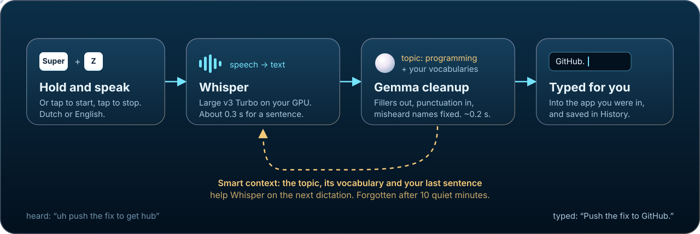

<p align="center">
  
</p>

<p align="center">
  <a href="https://github.com/JEMostert/delulu-talks/releases/latest"></a>
  
  
  <a href="LICENSE"></a>
</p>

Delulu Talks is push-to-talk dictation for Linux. Hold **Super+Z**, speak Dutch or English, let go, and the words are typed into the app you were using, cleaned up and spelled right. Speech recognition and cleanup both run on your own graphics card. Nothing you say leaves your computer.

## How it works

<p align="center">
  
</p>

- **Whisper** (Large v3 Turbo, whisper.cpp on Vulkan) turns your speech into text. From letting go of the key to typed text usually takes well under a second.
- **Or Parakeet** (NVIDIA Parakeet TDT 0.6B v3 on ONNX Runtime), the faster engine: it runs on the processor, recognizes 25 European languages on its own and needs no graphics memory. Pick it during setup or in **Settings → Dictation**; switching back and forth keeps both downloads.
- **Cleanup** with Gemma 4 E4B removes filler words and stutters, drops phrases you took back ("Monday, no sorry, Tuesday"), and adds punctuation. It never rephrases, and if anything goes wrong the raw text is typed instead.
- **Topics:** cleanup names what you are talking about, such as programming, gaming or finance, and uses it to fix words that were clearly misheard: "merch conflict" becomes "merge conflict" and "nerve it" becomes "nerf it".
- **Vocabularies:** on the **Cleanup** page you keep shelves of names and terms you say often, shown as glass jars on a reef. Put "T3 Code" on a Programming shelf and "ghthree code" comes out as "T3 Code". Starter shelves for Programming, Gaming & Discord, and Twitch & Streaming are one click away.
- **Smart context management:** the next dictation hands Whisper the topic's vocabulary and your last sentence, so names come out right from the start. It is forgotten after 10 quiet minutes, on restart, or with **Clear topic** in the tray menu, and can be turned off in **Settings → Dictation**.
- **The recording pill:** while you talk, a small click-through pearl at the bottom of the screen you are working on strings your voice as a row of pearls. It never takes focus.

Every transcript is saved in **History** before it is typed, with its topic and the raw version behind a **Cleaned up** toggle.

## Install

Download the package for your distribution from the [latest release](https://github.com/JEMostert/delulu-talks/releases/latest): `.pkg.tar.zst` for Arch and CachyOS, `.rpm` for Fedora, or `.deb` for Debian and Ubuntu.

You need a Wayland desktop (GNOME or KDE Plasma), a Vulkan graphics driver, and XWayland for the recording pill. Setup takes three steps: pick a microphone, allow the shortcut and typing into other apps, and download a speech model: Whisper (574 MB) or Parakeet (671 MB). The 5.2 GB cleanup model then downloads in the background.

## Memory and disk

<p align="center">
  
</p>

Both models live on the graphics card. Process monitors such as htop show the `delulu-cleanup` helper at about 3 GB, but most of that is the model file mapped from disk: clean page cache the kernel drops when it needs the memory. Turning cleanup off stops the helper and frees its 3.7 GB of graphics memory.

## Development

You need Rust, Bun, the GTK and WebKitGTK development libraries, ALSA, Vulkan headers, glslc, SPIRV-Headers and clang.

```sh
bun install
bun run build:helper   # the delulu-cleanup helper (llama.cpp with Vulkan)
DELULU_CLEANUP_HELPER=$PWD/target/release/delulu-cleanup bun run dev
```

`tauri dev` does not build the cleanup helper and only looks for it next to the debug binary, so point `DELULU_CLEANUP_HELPER` at the release build (or link it into `target/debug/`). The helper is a separate process because whisper.cpp and llama.cpp each bundle their own, incompatible copy of ggml. On Fedora, if clang cannot find its headers, set `BINDGEN_EXTRA_CLANG_ARGS` to the GCC include directory.

Checks: `cargo test --workspace`, `cargo clippy --workspace --all-targets -- -D warnings`, `bun run typecheck`, `bun test ui` and `bun run format:check`. Pushing a `vX.Y.Z` tag builds the packages and publishes the release, with notes from `docs/releases/<tag>.md`.

## License

[MIT](LICENSE). The Parakeet model is [NVIDIA Parakeet TDT 0.6B v3](https://huggingface.co/nvidia/parakeet-tdt-0.6b-v3) (CC BY 4.0), downloaded as the [int8 ONNX export by istupakov](https://huggingface.co/istupakov/parakeet-tdt-0.6b-v3-onnx).
