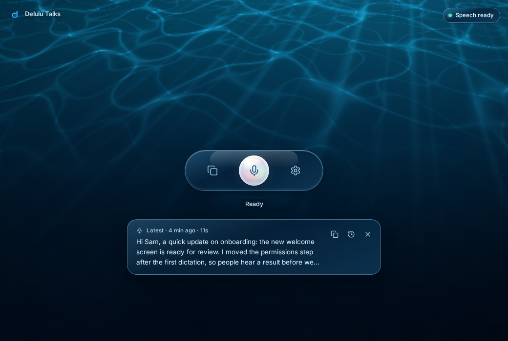

<div align="center">
  
  <p><strong>Private dictation that runs on your machine. It can talk back, too.</strong></p>
  <p>
    <a href="https://github.com/JEMostert/delulu-talks/releases/latest"></a>
    
    
  </p>
  <p>
    <a href="https://github.com/JEMostert/delulu-talks/releases/latest"><strong>Download the latest release</strong></a> ·
    <a href="docs/SIREN.md">Siren and Sonar</a> ·
    <a href="docs/ARCHITECTURE.md">Architecture</a> ·
    <a href="docs/MODEL_RESEARCH.md">Model research</a> ·
    <a href="docs/MAC_SUPPORT.md">Mac support</a>
  </p>
</div>

---

Delulu Talks is private, local-first, system-wide dictation for Linux and macOS. Hold your shortcut, speak, let go, and the text lands in whatever app you were typing in. It can also speak: your coding agents can talk back, and you can hold a hands-free conversation with them.

<picture>
  <source media="(prefers-color-scheme: dark)" srcset="docs/assets/controls-dark.png" />
  <source media="(prefers-color-scheme: light)" srcset="docs/assets/controls-light.png" />
  
</picture>

## What's inside

| Feature       | What it does                                                                                                                                                    |
| ------------- | --------------------------------------------------------------------------------------------------------------------------------------------------------------- |
| **Dictation** | Hold-to-talk (or toggle) from any app, pasted when you stop. Pick the speech model, microphone and shortcut in **Settings → Dictation**.                        |
| **Rewrite**   | A local model cleans up or restyles your text: every dictation (**Settings → Rewrite**) or one transcript at a time from History, with preview and undo.        |
| **History**   | Your transcripts: search, quick filters, edits, corrections and export. Import or drop audio and video files to transcribe them locally.                        |
| **Words**     | Word packs (Programming, Gaming), your own words and names, and text shortcuts that expand a spoken trigger into an exact saved block.                          |
| **Siren**     | Local text-to-speech: Kokoro on any CPU, or expressive Chatterbox Turbo on a GPU. Coding agents (Claude Code, Codex, T3 Code) speak through a local MCP server. |
| **Sonar**     | A hands-free conversation loop with your lead agent. Each sentence goes out as soon as it is transcribed, and the agent briefs you out loud.                    |
| **Pilot**     | A small local model (Qwen 3.5 0.8B) that routes what you say in Sonar: forward it to your agent, ask for status, cancel, stop or repeat. Off sends every word.  |

Siren, Sonar and Pilot live on the **Voice** page. The dock around the record button has four destinations: History, Words, Voice and Settings.

Speech engine sizes:

| Size                 | Model                    | Runs on                                       | Download |
| -------------------- | ------------------------ | --------------------------------------------- | -------- |
| **Small**            | NVIDIA Canary 180M Flash | Any CPU (English, German, French, Spanish)    | ~200 MB  |
| **Medium** (default) | NVIDIA Parakeet TDT 0.6B | Any CPU (English, or 25 languages with auto)  | ~630 MB  |
| **Large**            | Confucius4-R2T2          | NVIDIA GPU with ~4 GB (Linux) · Apple Silicon | ~4 GB    |

Rewriting is optional: set it up in **Settings → Rewrite** (Qwen 3.5 2B or Phi-4 mini), then turn on **Rewrite every dictation** or use **Rewrite** on single transcripts in History. It is off by default. On Wayland desktops with layer-shell (KDE Plasma, wlroots; not GNOME) a small recording pill floats above your apps.

## Install

Download a package from [GitHub Releases](https://github.com/JEMostert/delulu-talks/releases/latest). Linux/Wayland is the most thoroughly exercised platform. Windows is not supported.

| Platform                         | Package                   | Install                                                     |
| -------------------------------- | ------------------------- | ----------------------------------------------------------- |
| Linux, any distribution (x86_64) | AppImage                  | `chmod +x Delulu*_amd64.AppImage` and run it                |
| Fedora                           | rpm                       | `sudo dnf install ./Delulu*.x86_64.rpm`                     |
| Debian, Ubuntu                   | deb                       | `sudo apt install ./Delulu*_amd64.deb`                      |
| Arch, CachyOS, EndeavourOS       | pacman `delulu-talks-bin` | `sudo pacman -U delulu-talks-bin-*-x86_64.pkg.tar.zst`      |
| macOS 15+ (Apple Silicon)        | DMG                       | Open `Delulu*_aarch64.dmg` and drag the app to Applications |

- The rpm, deb and pacman packages pull in FFmpeg and Python. With the AppImage, install FFmpeg and Python 3.11–3.13 yourself.
- The recording pill needs gtk4-layer-shell and PyGObject with cairo: `sudo dnf install gtk4-layer-shell python3-gobject python3-cairo` (Fedora) or `sudo pacman -S gtk4-layer-shell python-gobject python-cairo` (Arch, CachyOS).
- The macOS app is not code-signed or notarized. If macOS blocks it, use System Settings → Privacy & Security → Open Anyway. It needs native arm64 Python 3.12 (`brew install python@3.12`).
- The AppImage and the macOS app update themselves from GitHub Releases. The rpm, deb and pacman packages update by installing the newer package. Your settings, history and models stay put either way.

## Your first minute

1. Open Delulu Talks. The first time, it opens **Settings → Dictation**.
2. Pick a size and choose **Download & set up**. The app sets up a local runtime and downloads the model.
3. Click into any text field and hold your shortcut (<kbd>Super</kbd> + <kbd>Z</kbd> by default), speak, then let go.
4. Your words are pasted where you were typing. Open **History** to review them, or turn on **Settings → Rewrite → Rewrite every dictation** to have them cleaned up automatically.

## Privacy

Speech, rewriting and voice models all run on your computer. Nothing leaves the machine except model downloads and the update check against GitHub Releases; there is no telemetry and no cloud transcription. History is kept locally (your latest 50 transcripts by default) and you can turn it off or trim it in **Settings → Privacy**. Recordings are deleted once they are transcribed.

## Run from source

You need [Bun](https://bun.sh/), stable [Rust](https://rustup.rs/), FFmpeg, and Python 3.11–3.13 on Linux or native arm64 Python 3.12 on Apple Silicon. On Linux, install the Tauri build dependencies first:

```bash
sudo dnf install webkit2gtk4.1-devel libappindicator-gtk3-devel librsvg2-devel alsa-lib-devel      # Fedora
sudo pacman -S --needed webkit2gtk-4.1 libayatana-appindicator librsvg alsa-lib                   # Arch, CachyOS
sudo apt install libwebkit2gtk-4.1-dev libayatana-appindicator3-dev librsvg2-dev libasound2-dev   # Debian, Ubuntu
```

Then:

```bash
bun install
bun run dev        # the desktop app with hot reload
bun run dev:web    # renderer only, with safe demo data
```

Development builds use their own **Delulu Talks Dev** profile, so they never touch your everyday settings or history.

## Build and test

```bash
bun run typecheck
bun run test:unit     # TypeScript renderer units
bun run test:python   # Python worker units, no model dependencies
bun run test:rust     # cargo test --workspace
bun run build         # typecheck + bundles for the current platform
```

`bun run test` runs all three unit suites; `bun run test:e2e` runs the Playwright browser checks. On Linux, `bun run build` writes the AppImage, deb and rpm to `src-tauri/target/release/bundle/`. See [testing](docs/VERIFICATION.md) for scope.

## Docs

- [Siren and Sonar](docs/SIREN.md): spoken output, the conversation loop, Pilot and connecting coding agents
- [Architecture](docs/ARCHITECTURE.md) and [decision records](docs/decisions/README.md)
- [Deep Sea design system](docs/DESIGN-SYSTEM.md) and [brand assets](docs/BRAND.md)
- [Model research](docs/MODEL_RESEARCH.md) and [model provenance](docs/model-provenance.md)
- [Mac support](docs/MAC_SUPPORT.md)
- [Testing](docs/VERIFICATION.md)
- [Release notes](docs/releases/)

## Licenses

Delulu Talks is [MIT licensed](LICENSE). It does not bundle model weights; each model keeps its own license:

- R2T2 (Large): Apache-2.0 inference code; the [weights](https://huggingface.co/netease-youdao/Confucius4-R2T2) use the [NetEase Model Use License](https://github.com/netease-youdao/Confucius4-R2T2/blob/master/MODEL_LICENSE).
- [Canary 180M Flash](https://huggingface.co/nvidia/canary-180m-flash) and [Parakeet TDT 0.6B](https://huggingface.co/nvidia/parakeet-tdt-0.6b-v3) (Small, Medium): [CC BY 4.0](https://creativecommons.org/licenses/by/4.0/), run through the Apache-2.0 [sherpa-onnx](https://github.com/k2-fsa/sherpa-onnx).
- [Qwen 3.5](https://huggingface.co/Qwen/Qwen3.5-2B) (rewriting, Pilot): Apache-2.0. [Phi-4 mini](https://huggingface.co/microsoft/Phi-4-mini-instruct): MIT.
- Vendored conversion helpers and their license are listed in the [third-party notices](docs/THIRD_PARTY_NOTICES.md).
