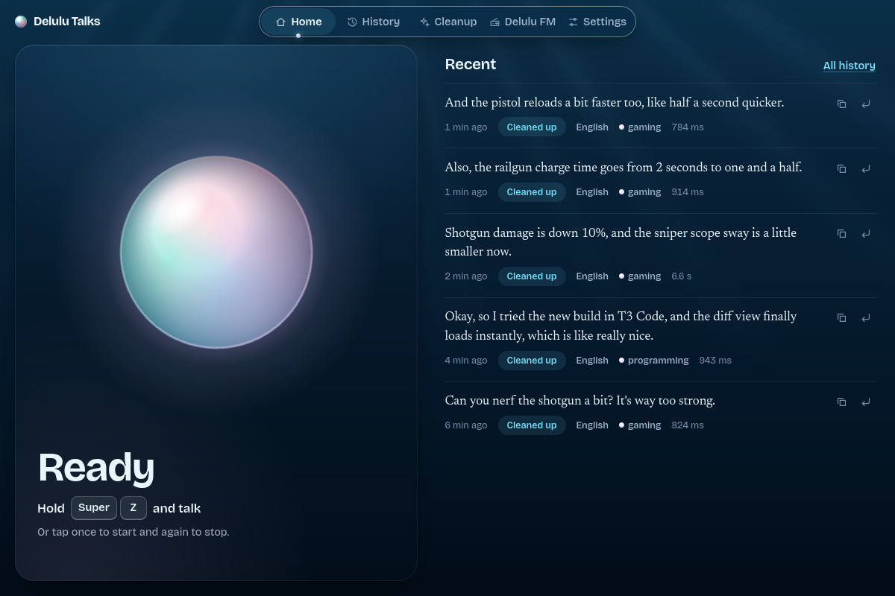
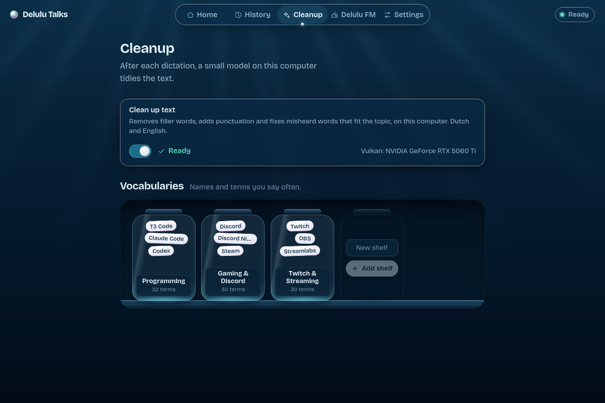
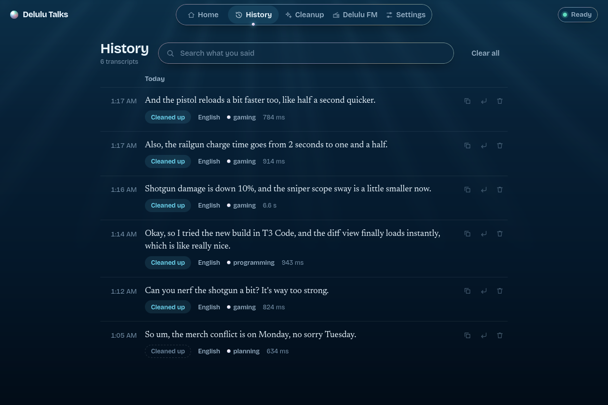

<p align="center">
  <a href="docs/assets/delulu-talks-reel.mp4?raw=true"></a>
</p>

<p align="center">
  <a href="https://github.com/JEMostert/delulu-talks/releases/latest"></a>
  
  
  <a href="LICENSE"></a>
</p>

# Delulu Talks

**Hold a key, say it, and it’s typed.** Delulu Talks is push-to-talk dictation for Linux. Hold **Super+Z**, speak Dutch or English, let go, and the words land in the app you were using, cleaned up and spelled right. Speech recognition and cleanup both run on your own graphics card. Nothing you say leaves your computer.

<a href="docs/assets/delulu-talks-reel.mp4?raw=true">The reel with sound</a> (MP4, 15 s, 6 MB) ·
[Install](#install) ·
[How it works](#how-it-works) ·
[Delulu FM](#delulu-fm)

<p align="center">
  <picture>
    <source media="(prefers-color-scheme: light)" srcset="docs/assets/screenshots/home-light.png">
    
  </picture>
</p>

## What it does

- **Cleans up what you said, not how you said it.** A small local model removes filler words and stutters, drops phrases you took back (“Monday, no sorry, Tuesday”), and adds punctuation. It never rephrases, and if anything goes wrong the raw text is typed instead.
- **Hears what you are talking about.** Cleanup names the topic, such as programming, gaming or finance, and uses it to fix words that were clearly misheard: “merch conflict” becomes “merge conflict” and “nerve it” becomes “nerf it”.
- **Spells your names and terms your way.** On the **Cleanup** page you keep shelves of names and terms you say often, shown as glass jars on a reef. Put “T3 Code” on a Programming shelf and “ghthree code” comes out as “T3 Code”. Starter shelves for Programming, Gaming & Discord, and Twitch & Streaming are one click away.
- **Remembers the conversation.** The next dictation hands Whisper the topic’s vocabulary and your last sentence (only when you speak the same language again), so names come out right from the start. It is forgotten after 10 quiet minutes, on restart, or with **Clear topic** in the tray menu, and can be turned off in **Settings → Dictation**.
- **Stays out of your way.** While you talk, a small click-through pearl at the bottom of the screen you are working on strings your voice as a row of pearls. It never takes focus.
- **Keeps a history.** Every transcript is saved in **History** before it is typed, with its topic and the raw version behind a **Cleaned up** toggle.

<table>
  <tr>
    <td width="50%"></td>
    <td width="50%"></td>
  </tr>
  <tr>
    <td><sub>Vocabularies on the <b>Cleanup</b> page, with the three starter shelves added.</sub></td>
    <td><sub><b>History</b>, with one entry switched back to what was actually heard.</sub></td>
  </tr>
  <tr>
    <td colspan="2"></td>
  </tr>
  <tr>
    <td colspan="2"><sub>The recording pill over a text editor, mid-sentence.</sub></td>
  </tr>
</table>

## Install

Download the package for your distribution from the [latest release](https://github.com/JEMostert/delulu-talks/releases/latest): `.pkg.tar.zst` for Arch and CachyOS, `.rpm` for Fedora, or `.deb` for Debian and Ubuntu.

You need a Wayland desktop (GNOME or KDE Plasma) and a Vulkan graphics driver; on GNOME the recording pill also needs XWayland. Setup takes three steps: pick a microphone, allow the shortcut and typing into other apps, and download a speech model: Whisper (574 MB) or Parakeet (671 MB). The 5.2 GB cleanup model then downloads in the background.

## How it works

<p align="center">
  
</p>

- **Whisper** (Large v3 Turbo, whisper.cpp on Vulkan) turns your speech into text. From letting go of the key to typed text usually takes well under a second.
- **Or Parakeet** (NVIDIA Parakeet TDT 0.6B v3 on ONNX Runtime), the faster engine: it runs on the processor, recognizes 25 European languages on its own and needs no graphics memory. Pick it during setup or in **Settings → Dictation**; switching back and forth keeps both downloads.
- **Cleanup** runs Gemma 4 E4B in a separate helper process, `delulu-engine llm` (llama.cpp with Vulkan), with the topic and your vocabularies.
- **Typing** pastes the result into the focused app through the desktop’s remote-desktop portal; when that is not allowed, the text is copied and you press Ctrl+V.
- **The recording pill** is its own small program, `delulu-pill` (about 5 MB of memory, no GTK): a layer-shell overlay on KDE Plasma and wlroots desktops, an XWayland window on GNOME. If it cannot draw, the app's built-in GTK pill takes over.

## Delulu FM

An optional radio station made on this computer, hidden until you turn on **Settings → Delulu FM**. Every song is new: the cleanup model writes its title, style and lyrics, [YuE2](https://huggingface.co/m-a-p/YuE2-3B) composes it on your graphics card, and between songs an AI host speaks in the station's language through the native voice (Supertonic 3). The **Delulu FM** page shows what is on air with its lyrics, what comes next and what played, and lets you skip, request a song or steer the mood and style.

- **What it needs:** a graphics card with a Vulkan driver, the music model and the cleanup model. The music model (YuE2 3B, 4 GB, CC BY-NC 4.0) is an explicit download in **Settings → Models**, where you can also cancel or delete it; nothing downloads on its own and dictation never needs it. The host is optional; without the voice model (**Settings → Voice replies**) the station plays music only.
- **Native:** YuE2 runs in `delulu-engine music`, a helper process shipped with the app that runs the model on ggml with Vulkan (no Python, no ComfyUI). It loads one part of the model at a time and exits after each song, so its graphics memory is free between songs. See [the parity and performance notes](docs/benchmarks/yue2-native/README.md). The engine also carries a second, faster music engine, ACE-Step 1.5 turbo with MIT weights ([crates/music-ace](crates/music-ace/README.md)); the station does not offer it yet.
- **Dictation comes first:** the radio goes quiet while you hold the hotkey, the music engine pauses while you dictate, and no new writing, music or speech starts while you dictate or just after.
- **Buffering:** a short programme is made ahead of playback (two songs or six minutes, at most three items). When nothing new is ready it replays a recent song. Playback is native, so it keeps playing with the window closed.
- **Recovery:** every step is saved. A song stopped half-way (off air, quit) keeps its words and is composed again later. A failed song is retried once, then the station pauses briefly.
- **Storage:** songs, history and settings live in `~/.local/share/delulu-talks/radio`, the music model in `~/.local/share/delulu-talks/models`.

On an RTX 5060 Ti (16 GB), a 2:38 song took 2:47 to make, peaking at 3.7 GB of graphics memory and 1.1 GB of RAM. Generation and playback share the graphics card with dictation; leave room for both or keep the station off.

## Memory and disk

<p align="center">
  
</p>

Both models live on the graphics card. Process monitors such as htop show the cleanup helper (`delulu-engine llm`) at about 3 GB, but most of that is the model file mapped from disk: clean page cache the kernel drops when it needs the memory. Turning cleanup off stops the helper and frees its 3.7 GB of graphics memory.

## Development

You need Rust, Bun, the GTK and WebKitGTK development libraries, ALSA, Vulkan headers, glslc, SPIRV-Headers and clang.

```sh
bun install
bun run build:engine   # delulu-engine: cleanup (llama.cpp), music (YuE2, ACE-Step) and voice (Supertonic) roles
DELULU_ENGINE=$PWD/target/release/delulu-engine bun run dev
```

The app looks for `delulu-pill` next to its own binary, then in `/usr/lib/delulu-talks`, and otherwise draws the pill with GTK: run `cargo build -p delulu-pill` once to get it in `target/debug/`. `delulu-pill --render listening 0.6 - out.png` draws one frame without a desktop, and `DELULU_PILL=gtk` forces the GTK pill. `tauri dev` does not build the engine and only looks for it next to the debug binary, so point `DELULU_ENGINE` at the release build (or link it into `target/debug/`). The app starts it once per role (`delulu-engine llm`, `delulu-engine music`; `delulu speak` starts `delulu-engine tts`); `delulu-engine probe` prints its version, roles and graphics devices without loading a model. The helpers are separate processes because whisper.cpp and llama.cpp each bundle their own, incompatible copy of ggml. The engine's ggml is built with `GGML_MAX_NAME=128` from `.cargo/config.toml`, which the vendored acestep.cpp needs; a build directory from before that setting needs `cargo clean -p llama-cpp-sys-2` once (see [crates/music-ace](crates/music-ace/README.md)). On Fedora, if clang cannot find its headers, set `BINDGEN_EXTRA_CLANG_ARGS` to the GCC include directory.

The log goes to the systemd user journal, so it never holds what you said: each dictation logs its timings, lengths, language, topic and model, but not the text. To debug transcription or cleanup, start the app with `DELULU_LOG_TEXT=1`; the dictation line then also carries the transcript and the raw text, and those stay in the journal after you delete the entry from History.

Checks: `cargo test --workspace`, `cargo clippy --workspace --all-targets -- -D warnings`, `bun run typecheck`, `bun test ui` and `bun run format:check`. Pushing a `vX.Y.Z` tag builds the packages and publishes the release, with notes from `docs/releases/<tag>.md`.

The reel at the top is made in code: a canvas program draws every frame, a Python synthesizer writes the soundtrack from the same beat map, and `docs/reel/make.sh` rebuilds the MP4 and the WebP. See [docs/reel](docs/reel/README.md).

## License

[MIT](LICENSE). The optional YuE2 music model ([m-a-p/YuE2-3B](https://huggingface.co/m-a-p/YuE2-3B), downloaded in ComfyUI's INT8 packaging from [Comfy-Org/YuE2](https://huggingface.co/Comfy-Org/YuE2)) is CC BY-NC 4.0: non-commercial use only. The optional ACE-Step 1.5 music models ([ACE-Step/Ace-Step1.5](https://huggingface.co/ACE-Step/Ace-Step1.5) by ACE Studio and StepFun, downloaded as [GGUF conversions by Serveurperso](https://huggingface.co/Serveurperso/ACE-Step-1.5-GGUF)) are MIT, their text encoder ([Qwen3-Embedding-0.6B](https://huggingface.co/Qwen/Qwen3-Embedding-0.6B)) Apache-2.0; the engine includes [acestep.cpp](https://github.com/ServeurpersoCom/acestep.cpp) (MIT, © The acestep.cpp authors) and yyjson (MIT, © YaoYuan), vendored with their notices in `crates/music-ace/vendor/`. The Parakeet model is [NVIDIA Parakeet TDT 0.6B v3](https://huggingface.co/nvidia/parakeet-tdt-0.6b-v3) (CC BY 4.0), downloaded as the [int8 ONNX export by istupakov](https://huggingface.co/istupakov/parakeet-tdt-0.6b-v3-onnx). The voices are [Supertonic 3](https://huggingface.co/Supertone/supertonic-3) by Supertone Inc. (BigScience OpenRAIL-M, use restrictions apply), downloaded from Supertone's repository on request; the text preprocessing ported from its sample code is MIT, Copyright (c) 2025 Supertone Inc. The reel uses Bricolage Grotesque and Newsreader, the app’s own typefaces, under the SIL Open Font License 1.1; they are downloaded when the reel is built, not stored here. The recording pill embeds a subset of Inter Bold by The Inter Project Authors, under the same licence ([crates/pill/fonts/OFL.txt](crates/pill/fonts/OFL.txt)).

## Spoken agent replies

Linux packages include `delulu`, a small CLI that lets coding agents speak short replies, and gives Delulu FM its host. It does not start dictation or touch the microphone.

```sh
delulu setup             # installs ~/.local/bin/delulu and the delulu-speak agent skill
delulu install-model     # explicit download: Supertonic 3, about 400 MB
delulu speak 'Done. The fix is ready for review.'
printf '%s' 'De build is geslaagd.' | delulu speak
delulu speak --output /tmp/reply.wav --lang en --voice M2 'Saved, not played.'
```

- **Voice:** [Supertonic 3](https://huggingface.co/Supertone/supertonic-3) by Supertone Inc. runs on the processor in `delulu-engine tts` (ONNX Runtime, no Python, no graphics memory). It speaks Dutch and English, picking the language per sentence (`--lang auto|nl|en`), with ten preset voices (`--voice F1…F5, M1…M5`; the defaults are set in **Settings → Voice replies**). Numbers, versions, file names and abbreviations are spelled out first, and a few English developer words inside Dutch get a Dutch respelling; add your own in `~/.local/share/delulu-talks/voice/lexicon-nl.tsv` (`word<TAB>respelling`).
- **Downloads:** only `delulu install-model` or **Install model** in Settings downloads the model, into `~/.local/share/delulu-talks/models/supertonic-3`, after showing its licence. Without it, `speak` fails with installation guidance and exit code 1.
- **Speed:** sentences stream: the first one plays while the next is made. After a reply the engine stays loaded for five minutes (`keepWarmSeconds` in `voice/settings.json`; 0 means a fresh process per reply), so the next reply skips the 1–2 s start-up.
- **Behaviour:** `delulu status` prints readiness as JSON. Replies queue under a per-user lock (a waiting reply gives up after ten minutes). Ctrl-C or SIGTERM stops the reply and returns 130 or 143; failures return 1. Input is capped at 16,000 bytes. `--volume` sets the stream volume (0 is silent) and never the system volume. Playback uses PipeWire's `pw-play`.
- **Chatterbox:** the earlier Chatterbox Turbo voice remains as an opt-in for an existing Python environment: `delulu setup --python /path/to/venv/bin/python`, `delulu install-model --engine chatterbox`, `delulu speak --engine chatterbox …`.

The voices are AI-generated. The model's [OpenRAIL-M licence](https://huggingface.co/Supertone/supertonic-3/blob/3cadd1ee6394adea1bd021217a0e650ede09a323/LICENSE) binds everything they say to its use restrictions, among them: no impersonation and no deception, and say that audio you share is machine generated.
